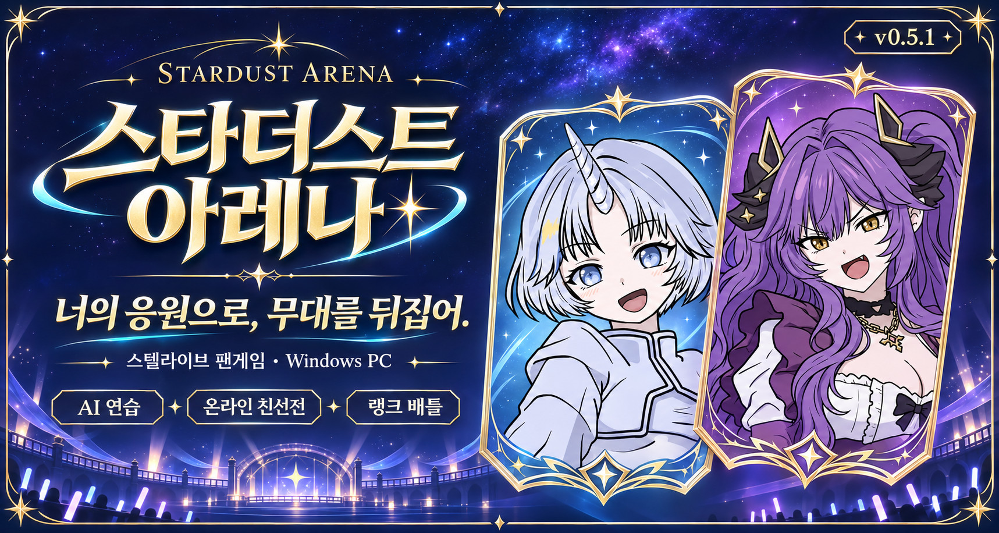
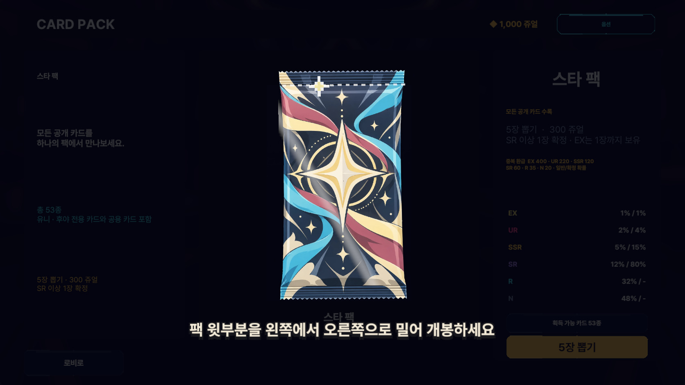
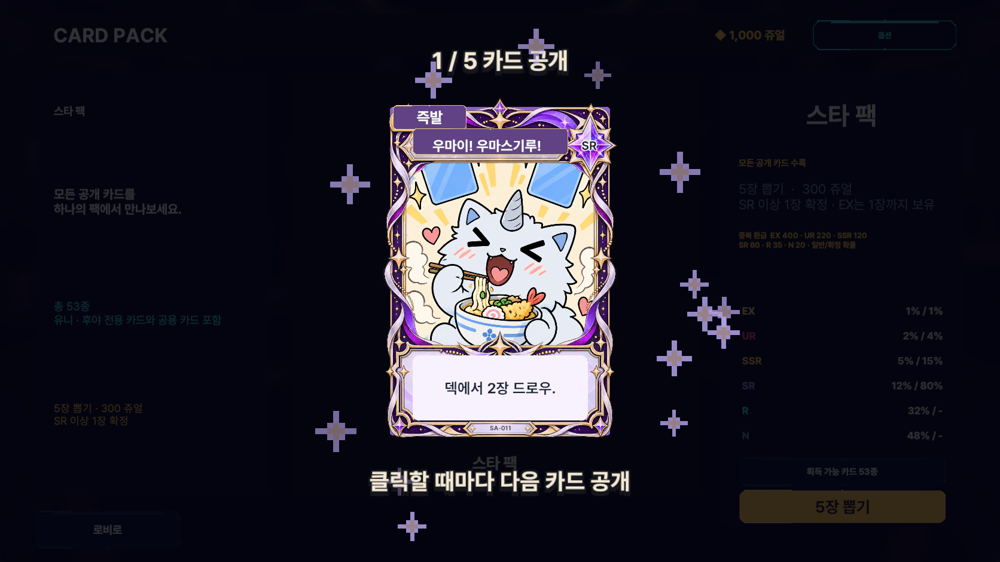
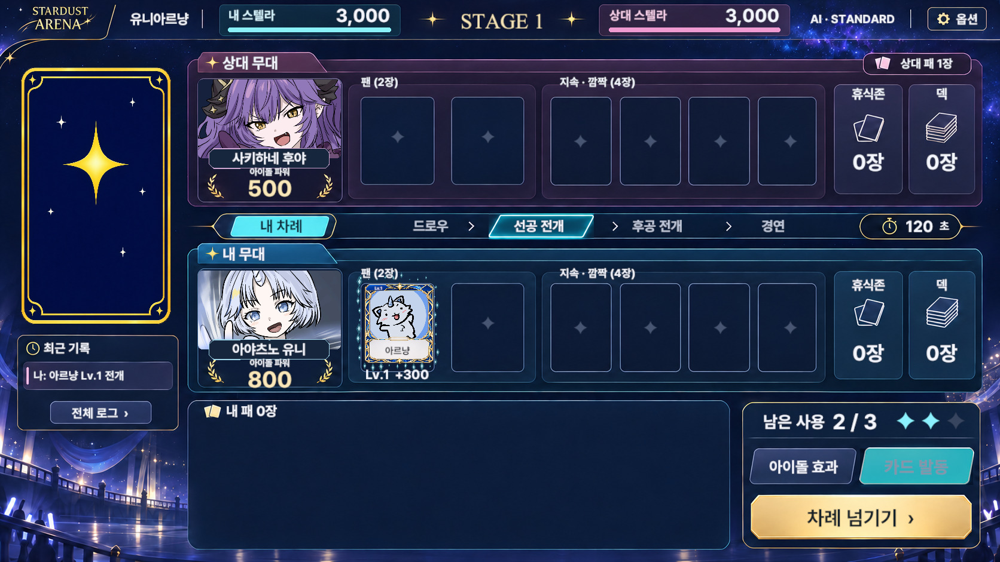
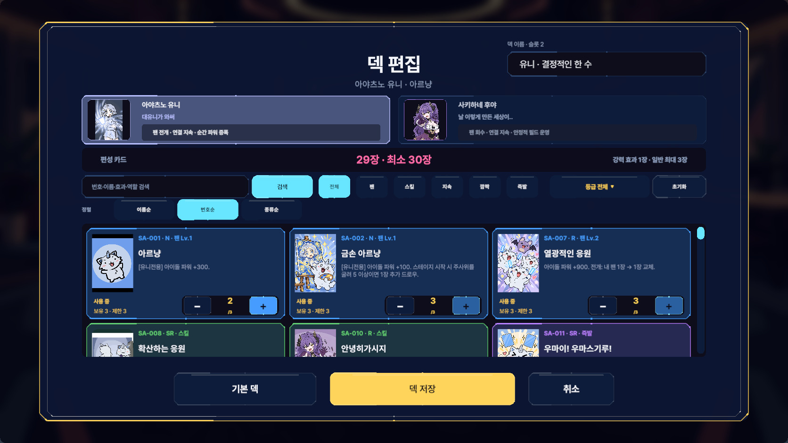
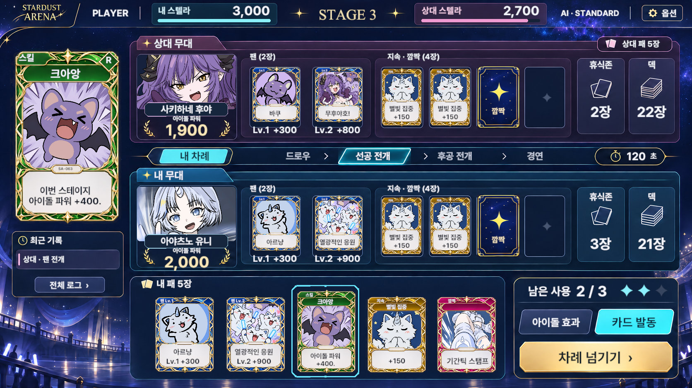
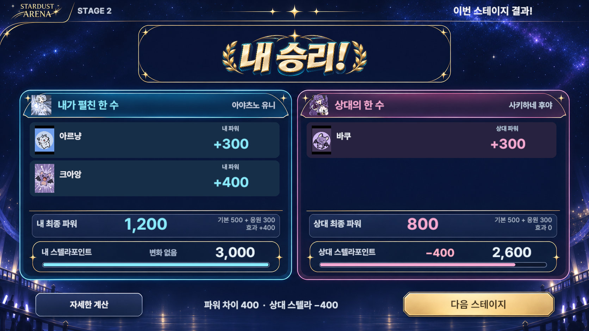
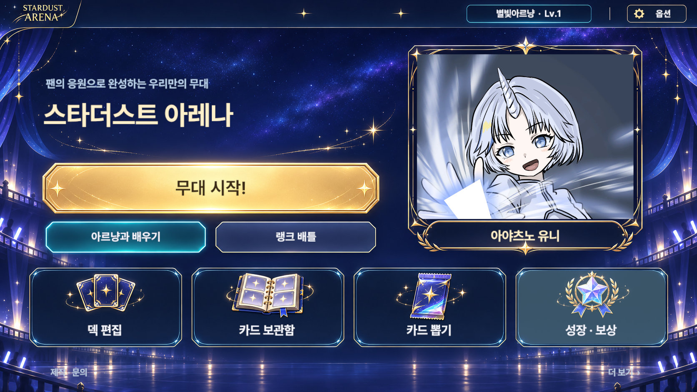

# STARDUST ARENA

스텔라이브 팬게임 · Windows PC 카드 배틀

## 지금 플레이하기

**[Windows PC 0.5.2 다운로드 · ZIP 약 323MB](https://github.com/subjobway22-rgb/stella-tcg/releases/download/v0.5.2/STARDUST-ARENA-PC-0.5.2.zip)**  
[최신 릴리스 · 업데이트 내용](https://github.com/subjobway22-rgb/stella-tcg/releases/tag/v0.5.2) · [홍보 이미지 모음](docs/promo/README.md)

**팬과 함께 아이돌을 강화하고, 한 차례 3장의 카드로 승부하세요.**

아이돌과 스타터 덱을 고른 뒤 아르냥의 안내로 시작할 수 있습니다. AI 연습, 온라인 친선전, 랭크 배틀을 지원합니다.

## 0.5.2 변경 사항

### 직접 뜯고, 한 장씩 공개하는 카드팩

팩 윗부분을 왼쪽에서 오른쪽으로 밀어 개봉합니다. 이후 화면을 클릭할 때마다 카드가 한 장씩 공개되며 짧은 슉 효과음이 재생됩니다. 중복 카드도 공개되고, 마지막에는 전체 결과를 확인할 수 있습니다.

### 필드에 놓이는 순간, 테두리 반짝임

내 카드와 상대 카드가 필드에 전개되면 해당 카드 테두리에 짧은 반짝임과 효과음이 나옵니다. 아래는 효과가 재생되는 순간을 캡처한 화면입니다.

### 덱 편집: 3열 목록과 오른쪽 스크롤바

카드 목록을 2열에서 3열로 늘리고, 오른쪽 스크롤바를 추가했습니다. 카드 정보와 추가·제거 버튼을 재배치했으며, 수량 변경 직후 스크롤이 되돌아가던 문제도 수정했습니다.

## 한 차례의 선택이 만드는 무대

팬 2칸, 지속·깜짝 존 4칸. 상대 무대와 남은 카드 사용 횟수를 보고 다음 한 수를 선택하세요. 깜짝카드는 1장까지 세트할 수 있습니다.

## 왜 이겼는지, 한눈에

내 정보는 왼쪽, 상대 정보는 오른쪽. 사용한 카드의 효과부터 최종 파워와 스텔라포인트 감소량까지 확인할 수 있습니다.

## 나만의 아이돌, 나만의 덱

로비에서 무대를 시작하거나 덱 편집, 카드 보관함, 카드 뽑기, 성장·보상으로 이동하세요. 덱은 30장 이상으로 구성합니다.

## 실행 방법

1. ZIP 파일을 내려받아 **폴더 전체를 압축 해제**합니다.
2. 폴더 안의 **STARDUST Launcher.exe**를 실행합니다.
3. 아이돌과 스타터 덱을 선택하고 아르냥의 안내로 시작하세요.

Windows 10/11 64비트용입니다. 0.5.2는 위 ZIP을 내려받아 압축 해제하면 됩니다. 기존 계정·덱·랭크 데이터는 게임 폴더 외부에 저장됩니다. 온라인·랭크에는 인터넷 연결이 필요하고, 사람과의 랜덤 매칭은 상대 플레이어가 대기 중이어야 연결됩니다. 계정 복구 코드는 별도로 보관하세요.

대표 배너는 홍보용 일러스트이며, 변경 사항 이미지는 0.5.2 실제 실행 화면입니다. 그 아래의 배틀·결과·로비 소개 이미지는 0.5.1 화면입니다.

## 오류 제보

화면 캡처와 아래 로그를 함께 전달해 주세요.

`%USERPROFILE%\AppData\LocalLow\STELLA Fan Project\스타더스트 아레나\Player.log`
